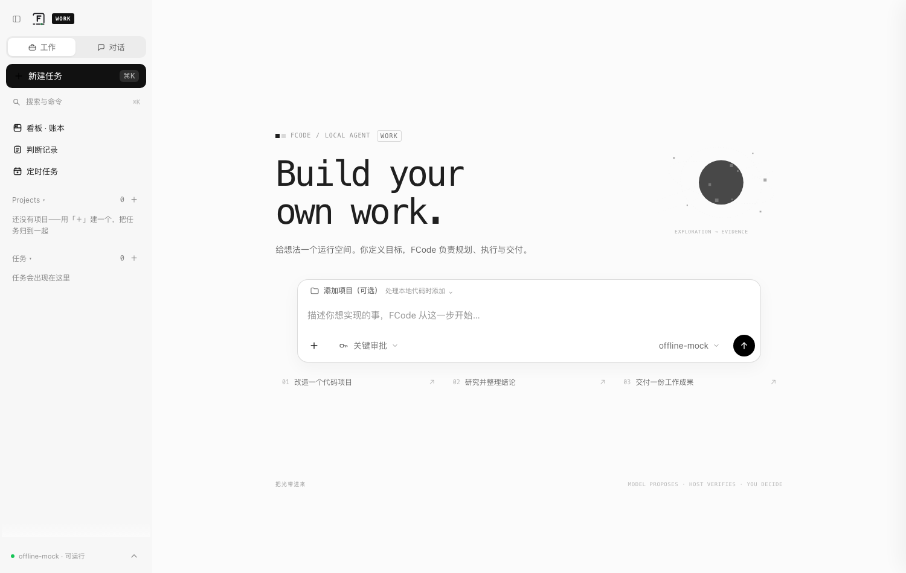

<div align="center">
  

  # FCode

  ## Build your own work.

  **让模型提议，让主机决定。**

  一个本地优先、可恢复、可审计的 Agent Runtime。

  `MODEL PROPOSES · HOST VERIFIES · YOU DECIDE`

  
</div>

---

FCode 是一个围绕**责任链**构建的 Agent 工作空间。模型负责理解与提议，Runtime 负责计划、权限、预算、工具、验证与恢复，人保留关键决定的控制权。

它不是给聊天窗口加上工具，而是让每一次行动都有依据、每一个结果都能检查、每一次失败都有明确的下一步。

## 不是更会回答，而是更能负责

一个 Agent 说自己完成了，并不等于工作真的完成。

FCode 把“完成”拆成可验证的过程：读取了什么证据，调用了哪个工具，为什么获得授权，消耗了多少预算，结果是否通过独立验证，崩溃后从哪里继续。

```text
                         ┌──────────────────────────┐
                         │      Operator control    │
                         │ approve · revise · resume│
                         └─────────────┬────────────┘
                                       │
Objective → Plan → Proposal → Gate → Approval → Tool
                       ↑                            │
                       │                            ↓
                       └────── Context ← Verify ← Observation

             Budget guards every action.
             A hash-chained event log remembers every decision.
```

### 模型不掌权

工具来自封闭注册表，参数通过 schema 校验，并同时匹配任务范围与主机授权。模型可以提议，但不能绕过门控，也不能自行宣布成功。

### 失败不乱来

调用在发送前计入预算。结果未知的请求不盲目重发；进程崩溃后从事件日志重建状态，已完成的轮次不重复执行。

### 全程可审计

审批、工具调用、观测、预算和人工干预进入同一条哈希链。轨迹可回放、可导出、可重新校验，而不是只有一段无法检查的文字总结。

## 四个核心层

| 核心 | 已实现 | 边界 |
| --- | --- | --- |
| **大脑** | Provider 抽象；mock、本地与 OpenAI 兼容模型；模型只输出动作提议 | 模型回答不等于结果已验证 |
| **规划** | 目标分解、todo、轮次循环、计划修订、失败停止 | 当前以单 Agent 执行为主 |
| **记忆** | SQLite 事件日志、上下文重建、运行历史、案例与事实投影、断点续跑 | 不是无限记忆或完整知识系统 |
| **工具** | 封闭注册表、权限门控、预算、签名收据、文件／命令／网页工具、MCP 桥 | 受限命令不是操作系统级沙箱 |

金融研究是第一个可独立复算的参考负载，通用文件、命令与网页委托是默认工作入口。运行内核不绑定行业。

## 开始工作

需要 **Python 3.11+**。离线演示零第三方依赖、零配置。

```bash
git clone https://github.com/Anhao1314/FCode.git
cd FCode/flowcredit
python demo.py
```

### 打开 Work 控制台

在 `flowcredit` 目录执行：

```bash
python viewer/server.py --repo . --port 8642
```

打开 `http://127.0.0.1:8642/`。

Work 用于规划与执行，Chat 用于流式对话；任务历史、审批、运行控制、证据与 Trace 回放共享同一个 Runtime。真实模型接入见 [Kimi 配置](flowcredit/docs/kimi.md)，密钥只保存在本机，不进入仓库。

### 构建桌面应用

```bash
bash desktop/build.sh
```

当前已实际验证 **macOS arm64** 构建。桌面端加载同一个控制台与内核，不维护另一套产品实现。

## 八个场景，检验八种纪律

```bash
python demo.py general-research --fast  # 通用委托：写、跑、修、复跑、归档
python demo.py full                     # 多轮研究：取证、口径桥接、独立复算
python demo.py tool-denied              # 越权工具：主机拒绝，工具不执行
python demo.py budget                   # 预算耗尽：发送前拦截
python demo.py budget-resume            # 追加预算：从失败点续跑
python demo.py crash                    # 真实 SIGKILL：恢复后不重复轮次
python demo.py unknown                  # 结果未知：不重发，凭收据对账
python demo.py open-ended               # 证据不足：诚实停止
python demo.py all                      # 顺序运行全部场景并自检轨迹
```

场景复用同一个 Runtime，通过不同主机策略与故障注入验证治理语义。每次运行生成 `work/demo/<scenario>.trace.json`，可阅读、回放并验证哈希链。

## 验证，而不是感觉

在 `flowcredit` 目录执行：

```bash
python -m unittest discover -s tests -q
node --test viewer/tests/*.test.js
python demo.py all
```

当前回归基线：**642 项 Python 测试、71 项前端测试、8 个端到端场景**。

覆盖权限与参数门控、预算、状态机、并发 CAS、事件篡改、收据伪造、独立重算、人工审批、崩溃恢复、Provider 纪律与真实 HTTP 服务边界。CI 使用 Ubuntu／macOS × Python 3.11／3.13 矩阵。

这些数字说明回归覆盖范围，不代表真实通用任务成功率。

## 诚实的边界

- 当前是治理较强的**单 Agent Runtime**，不是产品级多 Agent 集群。
- 本地工具与命令有应用层约束，但不构成操作系统级安全沙箱。
- Chat 附件以文本注入为主，不等于完整多模态理解管线。
- Chat 回答有事件链与收据，不代表每个回答都经过领域 verifier 验证。
- 网页内容会被保留为证据，但 Runtime 不因此证明网页内容真实。
- 通用任务仍受模型能力、工具覆盖、上下文质量与任务可验证性的共同限制。

知道何时不能完成，和完成工作同样重要。

## 文档地图

| 方向 | 文档 |
| --- | --- |
| 项目入口与完整使用说明 | [Runtime README](flowcredit/README.md) |
| 系统架构 | [architecture](flowcredit/docs/architecture.md) |
| 产品与判断哲学 | [philosophy](flowcredit/docs/philosophy.md) |
| 通用 Agent 能力 | [general-capabilities](flowcredit/docs/general-capabilities.md) |
| 上下文与记忆 | [context-management](flowcredit/docs/context-management.md) |
| 多 Agent 探索 | [multi-agent-lab](flowcredit/docs/multi-agent-lab.md) |
| 视觉与交互系统 | [design-system](flowcredit/docs/design-system.md) |
| 桌面控制台设计 | [desktop-design](flowcredit/docs/desktop-design.md) |
| 技术债与重构记录 | [refactor-evaluation](flowcredit/docs/refactor-evaluation.md) |

## 项目结构

```text
flowcredit/
  src/flowagent/   Agent Runtime、Provider、工具、记忆与场景
  viewer/          Work / Chat 控制台、SSE 与 Trace 回放
  desktop/         桌面应用入口与构建脚本
  tests/           Python 单元、集成与端到端测试
  docs/            架构、设计、能力与评估文档
  labs/            离线实验，不进入产品主路径
archive/           v1 Node 研究原型，不参与当前 CI
```

---

<div align="center">

**If it cannot be verified, it is not done.**

Apache License 2.0 · [LICENSE](LICENSE)

FCode 是一个独立开源项目，不是 Moonshot AI 官方产品。

</div>
