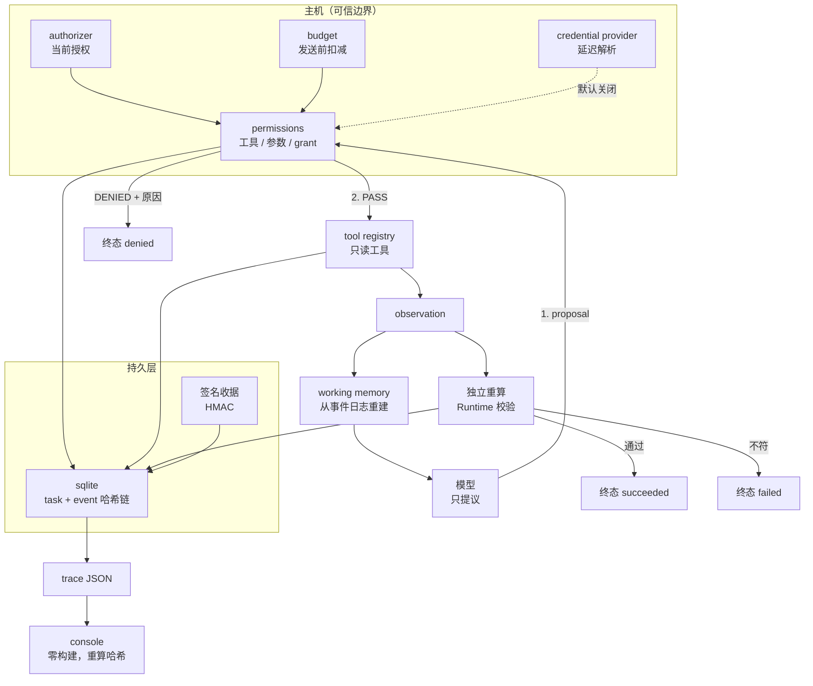
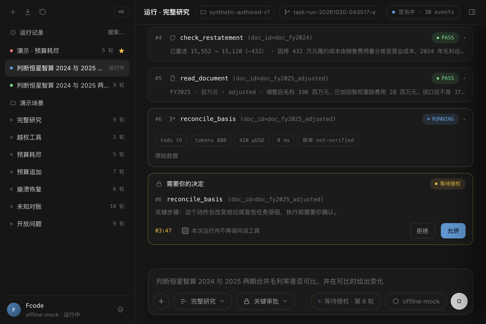

# FCode

**flowcredit 的 Agent Runtime：模型不掌权、出错不乱来、全程可审计。**

模型只能提议动作，主机掌握授权、预算、工具与凭证；Runtime 独立校验后才执行，每一步落进哈希链，崩溃可恢复，未知结果不重发。金融研究是第一个示例域，内核领域无关。

```sh
cd flowcredit && python demo.py
```

Python 3.11+，零第三方依赖，零配置，离线。在终端里给出场景菜单；无终端时直接跑完整故事。

```
第 6 轮   预算 calls 5/12  reads 5/20  cost 2500/20000 µUSD
  模型提议  reconcile_basis  doc_id=doc_fy2025_adjusted
  主机门控  PASS  schema, scope and grant all agree
  工具返回  FY2025  adjusted → IFRS  差异 -28 百万元
  预算扣减  calls 6/12  reads 6/20  cost 3000/20000 µUSD
...
 终态  SUCCEEDED（Runtime 独立重算通过）
  2024 毛利率  17.50%
  2025 毛利率  15.00%
  变化        -2.50 pp
 轨迹自检  通过：49 个事件，链头 d2043725c7d3…
```

## 理念

**智能可以外包，责任不能外包。** FCode 不追求更会说话的 AI，而追求能被复核、能被签字的结论。用户、交互、审美与架构的完整论述见 [philosophy.md](flowcredit/docs/philosophy.md)。

## 三个卖点

| | 主张 | 代码里怎么落实 | 怎么验证 |
| --- | --- | --- | --- |
| **模型不掌权** | 模型只能提议，主机门控工具、参数、预算、授权 | 工具是封闭注册表；参数按 schema 校验；工具必须同时出现在任务范围与主机 grant 里；模型不能传财务数值 | `demo.py tool-denied`：提议一个未注册工具，被拒且读取计数为 0 |
| **出错不乱来** | 崩溃可恢复，unknown 不重发、不重复扣费，结果独立校验 | 调用在发送前扣预算；`unknown` 只能凭匹配的签名收据显式对账；成功必须由 Runtime 重算通过 | `demo.py crash`：真实 SIGKILL 后 9 轮 9 次调用，无一轮重复；`demo.py unknown` |
| **全程可审计** | 每步签名收据 + 哈希链，Trace 可回放、可评测、防篡改 | 每事件 `sha256(canonical_json({sequence,type,payload,prev_hash,at}))`，链头写入任务行 | `flowcredit/viewer/` 用 `crypto.subtle` 重算全链，改一个字节就变红 |

## 架构



一次调用穿过四道关：**门控 → 预算 → 执行 → 独立重算**。任何一道不过，任务都不会被标记为成功。

## 七个场景

```sh
cd flowcredit
python demo.py full          # 完整研究，9 轮
python demo.py tool-denied   # 越权工具：主机拒绝，工具从未执行
python demo.py budget        # 预算耗尽：发送前拦住，已占用不退
python demo.py budget-resume # 预算追加：失败后续跑，已付的读取不重发
python demo.py crash         # 进程被 SIGKILL，重启续跑不重复
python demo.py unknown       # 供应商超时：不重发，凭签名收据对账
python demo.py open-ended    # 计划被卡住：诚实停止，不给算不出的数字
python demo.py all           # 顺序跑完并打印汇总表
python demo.py --serve       # 打开只读回放控制台
```

```
 场景           终态                     轮次   调用   读取    花费µUSD   轨迹
 full         succeeded               9    9    9      4500   ok
 tool-denied  denied                  1    1    0       500   ok
 budget       failed                  5    4    4      2000   ok
 budget-resume failed                  7    6    6      3000   ok
 crash        succeeded               9    9    9      4500   ok
 unknown      succeeded               9    9    9      4500   ok
 open-ended   failed                  9    9    9      4500   ok
```

其余六个场景都不改 Runtime 代码——它们是不同的主机策略与故障注入。这一点本身就是设计主张：可靠性不是特判出来的。

## 控制台

`flowcredit/viewer/` 是可实时运行的 Agent 控制台：真实任务用 SSE 流式渲染，也可以只读回放任意签名 trace。零依赖、零构建，由标准库 server 直接托管。

```sh
python3 flowcredit/viewer/server.py --repo .   # 打开 http://127.0.0.1:8642/
```



- 左侧：目录式的任务历史——每条记录两行（名称/时间 + 模板/轮次/成本），今天 / 昨天 / 更早分组带计数；悬停 `⋯` 菜单固定 / 重命名 / 删除；`↑↓` 在记录间移动、`Enter` 打开、`/` 聚焦搜索；示例场景收进折叠的附录。
- 委托入口：用户先发消息，clarifier 返回理解摘要和 2–4 个选项——关注点 → 输出 → 审批，任务卡确认后才创建运行；选择写入 `binding.spec`，可回退、取消或继续描述。
- 新建委托：点侧栏「＋ 新建委托」或 composer 的 `＋` 打开三步向导（类型 → 说明 → 审批），提交即开跑；也可以直接在 composer 输入任务，Enter 发送。
- 真实运行：Runtime 现场执行，Plan、预算、逐轮工具卡与哈希链边产生边渲染；`⌘.` 在轮次边界停止。
- 键盘入口：composer 以 `/` 开头弹出命令面板（Tab 补全、↑↓ 选择），↑↓ 翻输入历史；视觉沿用 Codex 终端语言：等宽元信息、20% 分隔线、选中填充 `#A4CDFB`。
- 本机偏好：左下角状态行右侧的齿轮（`⌘,`）让主区切到设置页——外观、委托默认、模型与工具、记忆统计、通知与快捷键、安全与关于；偏好只存本机，不影响签名链。
- LLM 层实验：真实模型训练期间，用文件式 oracle 坐进 Provider 位置；协议与结果见 [oracle-lab.md](flowcredit/docs/oracle-lab.md)。
- 数据采集：`FCODE_SOURCES` 配置主机源后，模型可用 `collect_source` 抓取并把结果变成可检索证据；配置与安全边界见 [data-collection.md](flowcredit/docs/data-collection.md)。
- Executive–Policy：决策包 + 候选动作 + fast path 的 P1 实验见 [executive-policy.md](flowcredit/docs/executive-policy.md)；控制台默认仍走旧 Provider。
- 运行中插话：composer 直接输入消息，排队后在下一轮写入同一条哈希链；后台会话与新建委托各占一个标签，切换不丢画面。
- 人工控制：审批门（关键步骤 / 逐步 / 自动）、计划跳过与提前、预算调高；失败于预算或轮次上限时可「追加预算并继续」，从事件日志续跑且不重发已付读取。
- 审计报告：运行结束后「签发报告」生成一份自包含 HTML 工作底稿（结论、账单、证据、人工决定、链附录），可打印、下载或离线转发。
- 只读回放：`cd flowcredit && python demo.py --serve`；页面加载时用 `crypto.subtle` 重算全链，改一个字节就变红。
- 右侧案卷：事件按轮分组，关键/全部/人工三档过滤，机械事件折叠为「过程 N 条」；工具契约与用量、完整性封印（链头可复制）、带行号可复制/下载的原文。
- 设计：**Paper & Proof / 纸与证**——纯白底稿、近黑墨色、楷体只留给人的判断、等宽只留给证据；虚线是校对痕，颜色只表达状态，零阴影、无渐变。规范见 [design-system.md](flowcredit/docs/design-system.md)，样式页 `viewer/design.html`；agent 的架构/交互约束见 [`.agents/skills/fcode-design/SKILL.md`](.agents/skills/fcode-design/SKILL.md)。
- 长期记忆：终态运行自动投影进案例簿与双时态事实簿；从签名轨迹重建：
  `PYTHONPATH=flowcredit/src python3 -m flowagent.memory.cases --repo .`、
  `PYTHONPATH=flowcredit/src python3 -m flowagent.tools.finance.facts --repo .`。

## 桌面端

`desktop/` 把同一个内核与控制台打包成可下载的桌面应用（macOS `.app` / Windows 目录），通过 GitHub Releases 分发，不走应用商店。

```sh
bash desktop/build.sh          # macOS: desktop/dist/FCode.app
open desktop/dist/FCode.app
```

- 窗口里加载的就是 `viewer/` 的同一套静态控制台——桌面端不是另一套实现
- 内嵌 server 绑定随机回环端口，并要求每次启动生成的 token（HttpOnly cookie 引导）；其他本地页面无法驱动 agent
- 运行记录写入 `~/Library/Application Support/FCode/runs`——打包后的 `.app` 只读，审计记录属于用户
- 原生能力：报告走系统保存对话框、完成通知走系统通知、窗口标题跟随委托；在浏览器里自动降级
- `.github/workflows/desktop.yml` 在 macOS / Windows 上构建，发布 Release 时自动附带 zip
- 未签名构建首次打开需右键 → 打开；正式分发再加 Apple Developer 签名与公证

## 能力清单

| 能力 | 状态 |
| --- | --- |
| 主机门控（注册表 / 任务范围 / grant / 参数 schema / effect） | 已实现 |
| 硬预算（calls / reads / cost / tokens 四维，发送前扣减） | 已实现 |
| 持久任务（sqlite WAL、`BEGIN IMMEDIATE`、序列号 CAS） | 已实现 |
| 事件哈希链（写入校验 + 读取重算 + 链头锚定） | 已实现 |
| 崩溃恢复（从事件日志重建工作记忆，不重放已完成轮次） | 已实现 |
| 计划驱动的多轮执行（目标 → 可修订的计划 → todo 推进） | 已实现（确定性，无 LLM） |
| 未知结果（不重发 / 不退费 / 签名收据显式对账） | 已实现 |
| 工具输出契约（声明式输出 schema + 工具版本，漂移输出直接拒绝并终止） | 已实现 |
| 证据摄入（沙箱文件 → 内容哈希 + 行锚点；拒绝绝对路径与越界） | 已实现 |
| 写效果工具（工作底稿追加：内容寻址、原子落盘、按策略审批） | 已实现 |
| 外部连接器（命名源 + 主机持有端点/凭证 + 超时不重试 + 大小上限） | 已实现（默认关闭） |
| 数据采集（`collect_source`：安全抓取 + HTML/JSON 转文本 + 入证据；支持 Crawl4AI 侧车） | 已实现（默认关闭） |
| 工具目录面板（允许/授权、effect、契约版本、每次运行用量） | 已实现 |
| 长期案例记忆（终态轨迹 → 确定性案例簿；召回事件入链；首轮上下文注入 top-3；删除只墓碑） | 已实现 |
| 双时态事实记忆（as-of / known-at 查询；修正追加不覆盖；每条事实带来源事件哈希） | 已实现（金融域抽取器） |
| 域模块协议（模块自给世界/工具/规划器/验证器；模板按模块分组；当前金融研究模块） | 已实现 |
| 独立验证（Runtime 重算，模型不能自报完成） | 已实现 |
| 人工审批门（关键步骤 / 逐步 / 自动、超时拒绝、本次运行免询） | 已实现 |
| 运行时人工控制（计划跳过 / 提前、预算调高、失败续跑） | 已实现 |
| 三步建单向导（类型 → 说明 → 审批，提交即开跑） | 已实现 |
| 运行中操作员消息（插话排队 → 下一轮入链，人与机器同一个哈希链） | 已实现 |
| 多会话并行（会话标签、后台运行持续流式、切换不丢画面） | 已实现 |
| 增量事件流（SSE 首帧快照 + 逐事件追加，长任务不再全量重发） | 已实现 |
| 斜杠命令与输入历史（/new /report /ledger /stop /allow /deny /help /clear，↑↓ 历史） | 已实现 |
| 审计报告签发（自包含 HTML 底稿：结论、账单、证据、人工决定、链附录，可打印/离线转发） | 已实现 |
| Evidence Authority（区分可用与不可用证据） | 已实现（金融域） |
| Trace 导出与可视化重算 | 已实现 |
| 实时控制台（SSE 直播 / 运行记录 / 只读回放） | 已实现 |
| SFT 数据管线（轨迹 → 训练样本，训练与推理 prompt 逐字节一致） | 已实现（2271 条样本） |
| LLM 层实验装置（文件式 oracle，复用真实 prompt / 门控 / 验证） | 已实现（实验） |
| 澄清式委托（消息 → 理解摘要 → 选项 → TaskSpec → 任务卡） | 已实现（确定性 clarifier） |
| Executive–Policy 决策包（候选动作 + fast path + LocalPolicy + choice SFT） | 已实现（P2 lab：上下文降 79.8%） |
| Packet 评测平面（结果 / 模型调用 / 修复 / tokens / packet 体积） | 已实现（MockPolicy 基线：2/2 正确，平均降 79.1%） |
| 模型验收（Ollama → packet eval → 结果/链/修复判定） | 已实现（等待本地 GGUF） |
| 本地模型供应商（Qwen3-4B LoRA · OpenAI 兼容 · 零依赖） | **骨架就绪**，门控关闭 |
| 真实供应商（一次性传输授权 + 凭证提供者 + 价格快照） | **门控关闭**，仅骨架 |

## 数字

- **152** 项单元与场景测试，全部离线
- **7** 个可复现场景，其中崩溃场景用真实 `SIGKILL`
- **0** 个第三方运行时依赖（只用标准库）
- **9** 轮完成一次完整研究，**4500 µUSD** 合成预算
- 哈希链 **49** 个事件，读取时全量重算
- 控制台 **4** 个静态文件 + **1** 个标准库 server，零构建、可离线

## 目录

```
flowcredit/          Python Runtime 与 Demo
  src/flowagent/
    core/            canonical JSON、契约与状态机、计划层、sqlite + 哈希链、签名收据
    runtime/         门控、预算、单轮 harness、多轮 loop（含恢复）
    tools/           封闭注册表；finance/ 只读工具与 Evidence Authority
    providers/       离线确定性 mock（三种策略）
    memory/          短期观测摘要 + 案例簿 + 双时态事实簿（确定性投影、可解释检索）
    trajectory/      记录、导出、独立重算
    demo/            CLI、终端渲染、七个场景、崩溃 worker
  viewer/            实时控制台 + Trace 回放（零依赖零构建）
  tests/             152 项 unittest
  docs/              架构、设计决策、框架对照、JD 映射
archive/             v1：Node.js 研究原型（保留，不参与 CI）
```

## v1 与 v2

`archive/node-prototype/` 是 v1：一个 Node.js 研究原型，用来回答"该不该训练模型"，结论是 `NO_GO`——规则基线解掉了全部冻结任务。它保留了 291 项测试、冻结预注册和一份诚实的负结果报告，标签 `archive/node-research-prototype`。

v2 不再问那个问题。它把 v1 里真正有价值的部分——可恢复、可审计、主机可控的执行语义——重写成 Python，并做成一条命令能跑完的演示。

## 边界

- 真实模型默认关闭。真实传输需要一次性授权（≤1h）、凭证提供者、主机复核的价格快照与硬预算，缺一不可。
- 演示中的金额、公司、资料全部是合成的，不是真实财报，也不构成任何投资或信贷意见。
- 签名收据证明的是"这次调用发生了、内容是什么"，不证明供应商账单准确。`external_billing` 恒为 `not-verified`。
- 哈希链保护的是本地记录的一致性。能同时改写数据库与签名密钥的攻击者不在威胁模型内。
- 未做：RAG、多智能体、MCP、FastAPI、前端工程化。这些不是遗漏，是刻意的范围边界。

## 许可

Apache License 2.0（见 [LICENSE](LICENSE)）。`archive/node-prototype/vendor/` 保留其原始 MIT 许可证。

内核保持零第三方运行时依赖；桌面端的打包依赖（pywebview、PyInstaller）属于分发层，不进运行时。

控制台的手绘图标来自 [oreo-design/doodle-icons](https://github.com/oreo-design/doodle-icons)（MIT），许可证随图标存放于 `flowcredit/viewer/icons/doodle/LICENSE`。
