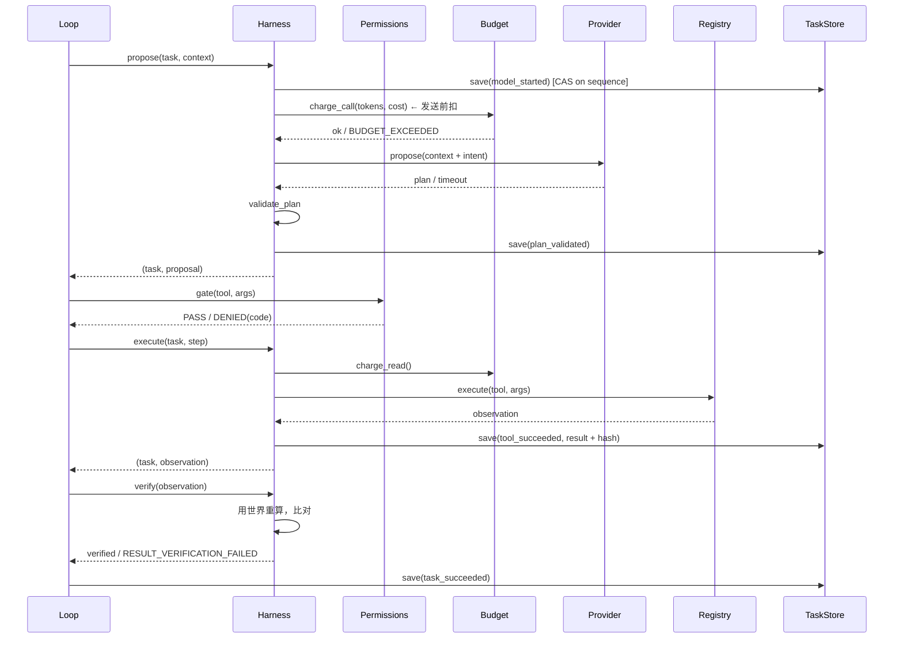

# 架构

**状态：当前权威** — 本文件描述**已实现**的运行时（门控、预算、循环、链、恢复）。从这里读起。相关：下一版框架 design 见 [framework.md](framework.md)；语言层规范见 [voice.md](voice.md)；与外部框架的对照见 [framework-mapping.md](framework-mapping.md)；能力与 MCP 桥边界见 [general-capabilities.md](general-capabilities.md)。最后核对：2026-10-29。

> 下一版框架（Policy / Voice 分层、领域模块、评测与学习闭环）见
> [`framework.md`](framework.md)。本文描述当前已落地的运行时。

## 分层与依赖方向

```
demo/ benchmark/  CLI、场景、任务评测、provider 显式选择
   │
runtime/          门控、预算、harness、loop、恢复与只读回放
   │
tools/  providers/(mock·local·kimi·deepseek·oracle)  memory/  trajectory/
   │
core/             哈希、契约、存储、收据
```

依赖是单向的：`core` 不 import 包内任何其他模块；`runtime` 可以 import `core` / `tools` / `providers`；只有 `demo`、`benchmark` 和测试从上层装配 Runtime。这条约束让安全属性可以脱离展示层单独测。

`tools/finance/` 是示例域，不是内核。`runtime` 不 import 它——换一个领域只需要提供自己的 `build_*_tools` 和 `authority`。

## 一次调用的完整路径



关键点：**每一次状态变化都是一次 `save`，都进哈希链**。没有"内存里改一下最后一起写"的路径。

## 任务状态机

```
created ──▶ planning ──▶ planned ──▶ running ──▶ verifying ──▶ succeeded
                │            │           │
                │            │           ├──▶ paused ──▶ running
                │            │           ├──▶ failed
                │            │           ├──▶ denied
                │            │           └──▶ recovery_required ──▶ running
                │            └──▶ denied
                └──▶ failed / recovery_required
```

合法迁移表在 `core/contracts.py::TASK_TRANSITIONS`，由 `core/store.py::_assert_legal_change` 在事务内强制执行。`succeeded` 与 `denied` 是单向终态。

两条容易问到的边：

- `running → recovery_required`：unknown 可能发生在任何一轮，不只是第一轮。
- `recovery_required → running`：对账成功后回到它当时所在的轮次。

模型侧：`not_started → started → validated / unknown / failed`，且 `validated → started` 允许，因为每一轮都是一次新调用。

## 计划层

目标是可修订的对象，不是散落在策略里的步骤表。

```
Goal（objective + 成功判据）
  └─ Plan（revision，持久化）
       └─ Todo（text / tool / arguments / done_when / status / evidence）
```

四个规则：

1. **计划是派生视图。** 每次运行时，`Loop.rebuild_plan()` 都会把已提交的观测重放回规划器，而不是信任任务体里存的那份快照。进程在「观测已提交、计划未更新」之间崩溃，快照会落后一步，重放永远是对的。
2. **todo 的完成必须带证据。** `evidence` 存的是观测结果的哈希，可以一路回溯到事件链。没有证据的 `done` 是不被允许的。
3. **规划器是域代码。** `tools/finance/planner.py` 提供蓝图和判据，`core/plan.py` 只管状态机。换领域不动内核。
4. **拒绝也是一种结果。** 工具跑完并报告「做不了」，对应 todo 是 `blocked` 而不是 `pending` 或 `failed`。`open-ended` 场景就是这条：公司没有公布桥接说明，`t6` 被 blocked，最后以 `INSUFFICIENT_EVIDENCE` 收尾，报告里带着领域原因。
5. **结果按身份绑定，不按正文。** 结果 todo 与观测的匹配（`Loop._same_result_step`）只看**标识参数**：工具、路径、文档 id、URL。提议者自己撰写的正文（文件内容、锚点、底稿段落）标 `Param(identity=False)`，不参与匹配——模型写出一份比计划更完整的 `results.md` 时，文件存在、哈希由校验器独立复核，运行不该以 `RESULT_INCOMPLETE` 收尾。没声明 identity 的工具保持严格比较，语义没有悄悄放松。
6. **形状错误给一次补救。** 提议通过了计划校验、但在门控处因参数形状被拒（`TOOL_ARGUMENTS_INVALID`，例如空的 `new_text`）时：什么都没执行、也没有未知结果，所以运行记一条 `proposal_rejected`（可审计）、把错误放进下一轮 context 的 `rejected_proposals`，让模型改正后重提；最多两次（`MAX_PROPOSAL_REPAIRS`），仍改不对就照旧以 `denied` 收尾。**范围与效应违规不在其列**（未注册工具、越出 grant、效应不允许）——那是治理事件，第一次就停，`tool-denied` 场景正是这条的演示。

## 持久层

单文件 SQLite，WAL 模式，`synchronous=FULL`。

| 表 | 作用 |
| --- | --- |
| `task` | 当前任务体、序号、体哈希、链头哈希 |
| `event` | 追加式事件，`(task_id, sequence)` 主键，含 `prev_hash` 与 `hash` |
| `receipt` | 签名收据，`ref` 由 intent+plan 派生 |
| `meta` | 签名密钥（首次使用时生成） |
| `budget` | 四维计数器 |

写入用 `BEGIN IMMEDIATE` 串行化，读取时 `verify_chain` 全量重算：

```
hash_n = sha256(canonical_json({sequence, type, payload, prev_hash, at}))
```

任何一处被改，`load` 抛 `CHAIN_TAMPERED`。删掉最后一条，`CHAIN_ROLLBACK`。

## 恢复

崩溃后重启：

1. `store.load(task_id)` 重算全链，确认没有被截断或篡改。
2. `Loop.restore(task)` 从 `tool_succeeded` 事件重建工作记忆。
3. `FinanceWorld.apply_state(memory.state())` 让世界也知道"哪些资料读过了"。
4. `Loop.pending_step(task)` 检查是否有已批准但未执行的提案（对账后的情况）。
5. 继续跑，轮次号取自 `task.model.attempts`，不会重复。

工具侧还有一个更窄的未知结果窗口：`tool_started` 已提交，但进程可能在 handler 前、handler 副作用后或结果提交前消失。`runtime/recovery.py` 对未闭合调用只做对账与标记，不重发；主机证据区分 `observed`、`not_observed` 与 `unknown`。`runtime/replay.py` 只消费事件字典，比较动作顺序、结果哈希、计划与终态，不接触工具注册表。预算计数仍在 SQLite，恢复前后独立比较。

版本化基准在 `benchmark/` 中复用上述正式链路；`ScriptedProvider` 只给提议，独立 verifier 直接检查文件、命令、事件、收据与 canary。运行方法和统计分母见 [runtime-benchmark](runtime-benchmark.md)，真实 SIGKILL 录屏顺序见 [demo-script](demo-script.md)。

## 扩展点

| 想加什么 | 改哪里 | 不用改什么 |
| --- | --- | --- |
| 新工具 | `tools/` 加一个 `ToolSpec` | runtime 一行不动 |
| 新领域 | 新 `tools/<domain>/` + 自己的 authority | core / runtime 一行不动 |
| 真实供应商 | `providers/` 实现 `Provider`，demo 加显式 `--provider` | 门控、预算、收据全部复用 |
| 新场景 | `demo/fixtures.py` 加一条数据 | runtime 一行不动 |

最后一行是这套架构最想证明的事：**场景是数据，不是分支**。

## 文件索引

| 文件 | 职责 | 关键不变量 |
| --- | --- | --- |
| `core/hashing.py` | canonical JSON + sha256 | 拒绝 float；键排序；UTF-8 |
| `core/plan.py` | Goal / Plan / Todo 状态机 | done 不可逆；evidence 必填 |
| `core/contracts.py` | 版本、异常、Task/Plan/Step、迁移表 | 未知键一律拒绝 |
| `core/store.py` | sqlite、事务、哈希链、CAS | 序列号由 store 独占 |
| `core/receipts.py` | HMAC 收据 | 签名不符即 `UNTRUSTED` |
| `runtime/permissions.py` | 三道门控 | 拒绝有稳定错误码 |
| `runtime/budget.py` | 四维预算 | 发送前扣，不退 |
| `runtime/harness.py` | 单轮机制 + 独立重算 | 成功只能由 verify 产生 |
| `runtime/loop.py` | 多轮 + 恢复 | 轮次不重复；支持 packet 模式与 fast path |
| `runtime/recovery.py` | 工具未知结果对账 | 不重发；区分副作用证据；重复恢复拒绝 |
| `runtime/replay.py` | 只读状态投影 | 不接触 registry；比较动作、收据、计划与终态 |
| `benchmark/` | 版本化任务与独立验证 | 复用正式 Runtime；指标保留分子分母与任务边界 |
| `runtime/policy.py` | DecisionPacket / ActionCompiler / Policy | 模型只选候选；单候选不调模型 |
| `providers/local.py` | OpenAI 兼容本地 Provider | 零成本如实记账；失败 unknown，不重试 |
| `providers/local_policy.py` | LocalPolicy | choice-only；一次修复；失败不编造 |
| `providers/kimi.py` | Kimi API Provider | 价格必填；输入全量计价；HMAC receipt；不回退 |
| `providers/deepseek.py` | DeepSeek API Provider / Policy | 价格快照；无 repair；不回退 |
| `providers/deepseek_config.py` | DeepSeek Host 配置 | key 脱敏；缺价格启动前失败 |
| `demo/provider_factory.py` | 显式 provider 装配 | 只有主机选择，无 silent fallback |
| `providers/packet_prompt.py` | packet prompt 渲染器 | 训练/推理共用；不含工具目录 |
| `sft/choices.py` | choice SFT 导出 | packet + policy_decided → 样本 |
| `sft/evaluate.py` | packet 评测平面 | 结果、调用、修复、tokens、packet 体积 |
| `sft/accept.py` | 本地模型验收 | Ollama → packet eval → PASS/FAIL |
| `review.py` | 终态运行的人工判断 | `review_decided` 入链；不改终态 |
| `review_profile.py` | 历史判断投影 | 只读 trace；建议只预填，不提交 |
| `demo/packet.py` | Executive–Policy 实验运行器 | 对照 packet 与旧上下文体积 |
| `memory/context.py` | 派生上下文 | 每轮重算，不累积 |
| `memory/cases.py` | 长期案例簿 | 终态轨迹的纯函数投影；分数为整数基点；删除只墓碑 |
| `memory/facts.py` | 双时态事实簿 | 修正追加不覆盖；valid-time / transaction-time 分离 |
| `tools/finance/facts.py` | 金融事实抽取 + 重建 CLI | 只读已提交观测；事实带事件哈希 |
| `tools/connectors.py` | 主机源注册表 + 安全抓取 | 模型只点名；HTTP / Crawl4AI 两种 adapter；凭证不落链 |
| `intake.py` | 澄清式委托 | 无状态；回复 + 选项 + TaskSpec；字段白名单校验 |
| `providers/oracle.py` | 文件式实验 Provider | 复用真实 prompt；缺回复即 unknown |
| `demo/oracle.py` | LLM 层实验运行器 | 隔离 workdir；不污染控制台记忆 |
| `viewer/design.css` | Paper & Proof tokens / 组件 | 新样式唯一入口；旧层只留布局 |
| `viewer/design.html` | 设计系统样式页 | tokens、类型、组件、做与不做 |
| `trajectory/recorder.py` | Round/收据记录 + 顶层披露 | fault injection / disclosure 从 receipt 提升到 trace metadata |
| `trajectory/exporter.py` | 导出 + 重算 | 与 viewer 算法一致 |
| `demo/runner.py` | 装配 | 唯一选择具体实现的地方；批成本闸只在任务间触发 |
